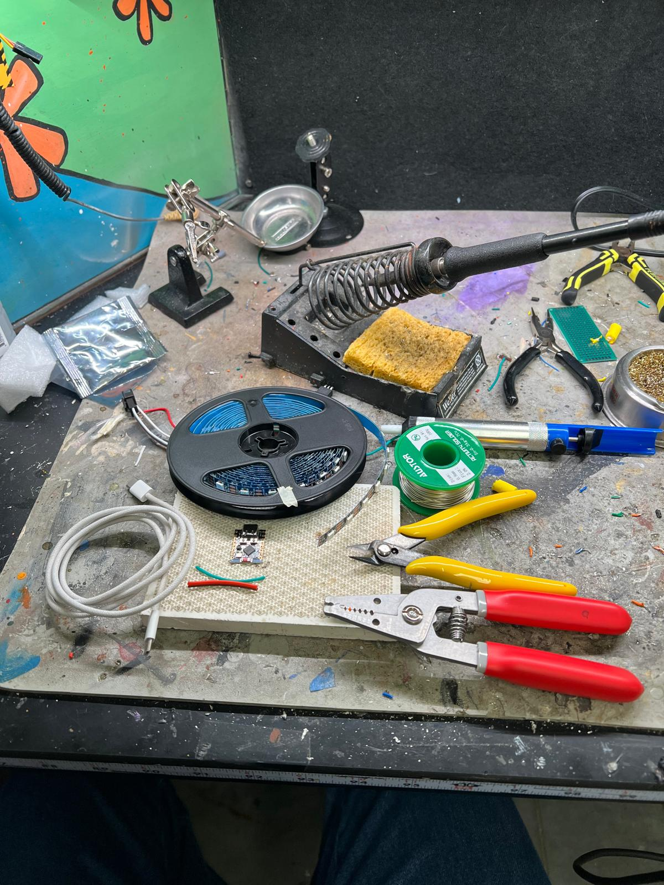
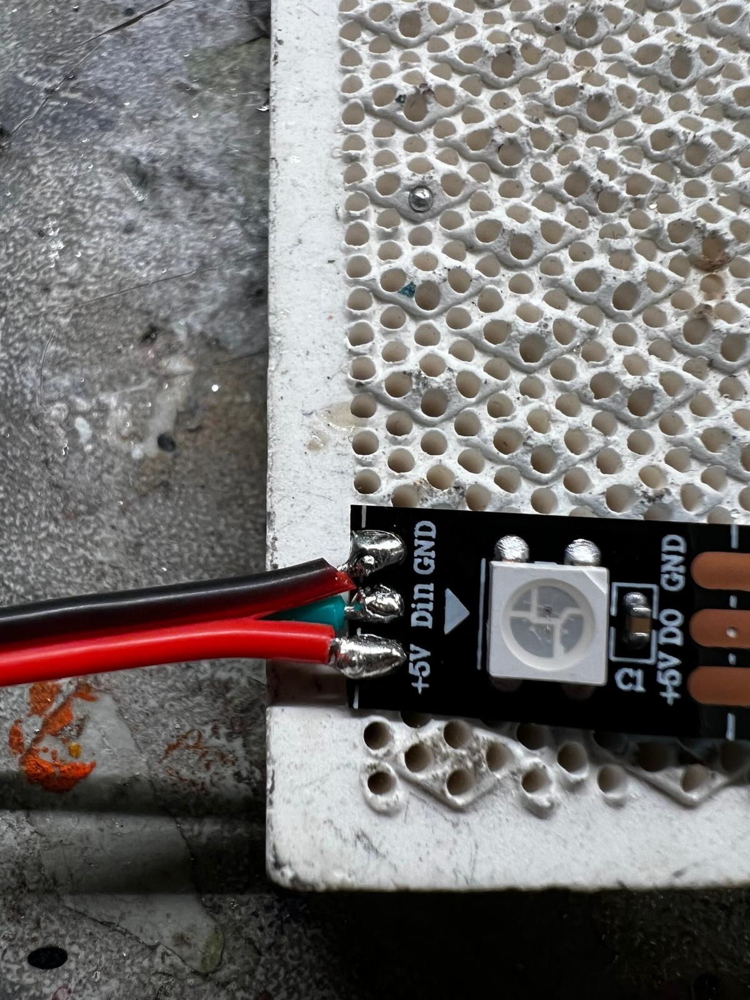
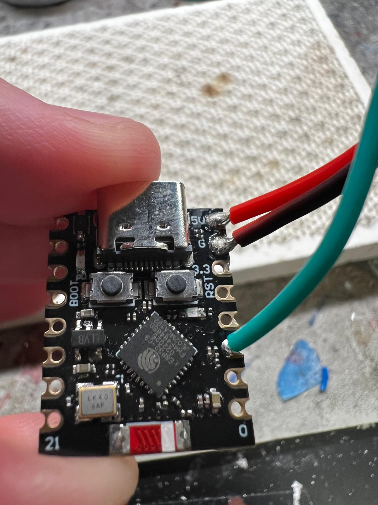
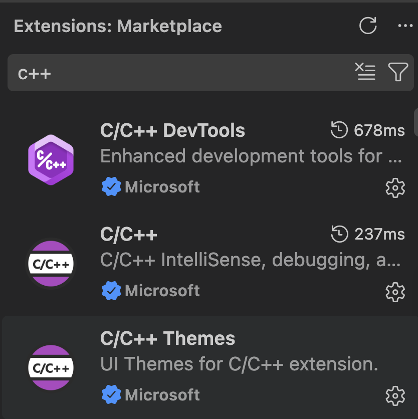

# Makerspace Project xyz 
# Add LEDs to your Clothes
*If you are here from the QR code on the Zine or the link in the Makerpedia, feel free to skip to the [Software Section](#software). Otherwise start with the [Hardware Section](#hardware)*
## Hardware 
### Required Equipment/Components
1. Portable Charger (bring your own)
2. USB-C Data Transfer Cable 
3. ESP32 - C3 Super Mini
4. Addressable LED Strip (amount of LEDS in the strip, up to the maker)
5. Red, and Black 18 gauge flexible wire
6. 18 gauge flexible wire of a third colour
7. Wire Cutter
8. Wire Stripper 
9. Soldering Iron 
10. Solder

## Assembly
1.  Using the Wire Cutters, cut a 2 inch segment of both the Red and Black 18 gauge flexible wire.\
Using the Wire Strippers, strip one of the ends on each wire (the stripped segment should be about 5mm long).\
Using the soldering iron and the solder, tin the stripped end of the Red wire. Repeat with the black wire.\

2. Repeat Step 1. with the third wire. Make sure that this third wire is a different color.
3. Solder the Red **tinned** wire to the +5V pad on the LED Strip.
4. Solder the third **tinned** wire to the Din pad on the LED Strip.
5. Solder the Black **tinned** wire to the G pad on the LED Strip.\

6. On the non-soldered end of the Red wire, do step 1. again.
7. On the non-soldered end of the Black wire, do step 1. again.
8. On the non-soldered end of the third wire, do step 1. again.
9. Solder the newly tinned end of the Red wire to the 5V pin hole on the ESP32.
10. Solder the newly tinned end of the Black wire to the G pin hole on the ESP32.
11. Solder the newly tinned end of the third wire to one of the other numbered pin pads in the ESP32 (**NOTE: DO NOT SOLDER THIS WIRE TO THE 3.3, 20 OR 21 PIN PADS. CHOOSE ANY OF THE OTHER 0-10 PIN PADS THAT CAN BE SEEN IN THE BACK OF THE BOARD**)\ 

12. Your hardware is now fully assembled, move on to the [Software](#software) section to set up your board!
## Software 
### Set-up
1. Download and install VS Code using the instruction presented here: [Download Visual Studio Code](https://code.visualstudio.com/download?_exp_download=d53503e735)
    - If you do not have git installed in your device, you need to do that, and can do so here: [Install Git](https://git-scm.com/install/mac)

2. Install the C/C++ extensions to VS Code like so:
    - CLick on extensions 
    - Search for "C++" and click on the one called "C/C++ DevTools" made by Microsoft  It will install a set of extensions which will be useful in the development of these. 
    Note: If C/C++ by microsoft are not installed by default, install those as well!

3. Download and install Platform.io to your VS Code using the instructions presented here: [Download PlatformIO IDE](https://platformio.org/platformio-ide)

4. Clone this repository to your device by running the following command on your VS code terminal: 'git clone <insert address here>'

5. Connect your ESP32 to your computer using the USB-C data transfer cable. If your ESP32 is not recognised by your computer, press and hold the BOOT button, and press and release the RST button as you keep holding the BOOt button.

6. 
## Project Folder Structure explanation
* [include](include): Automatically created folder which you can use to store the header files for your projects when using multiple files. It is not something that you should concern yourself with for now, unless you want to dig deeper into coding.
* [lib](lib): Intended to store private libraries. Again it is not something that you should concern yourself with for now, unless you want to dig deeper into coding.
* [src](src): Or source is our main folder, this is where most if not all of your code will be stored. For the purposes of this demonstration it only has one file which is main.cpp. In Arduino programming at least 1 file needs to be named main.cpp as it will be the file that gets called on boot.
    - A [readme](src/Readme.md) is included in src with images that show how the different examples should look in person.
* [test](test): A platformio folder where you can create test cases for the code in src. It is not something that you should concern yourself with for now, unless you want to dig deeper into coding.
* [.gitignore](.gitignore): A file that tells github which folders to ignore when we are uploading things to its servers. This is really useful when you want to keep track of your project using Github, but do not want some private or heavy files to load onto github.